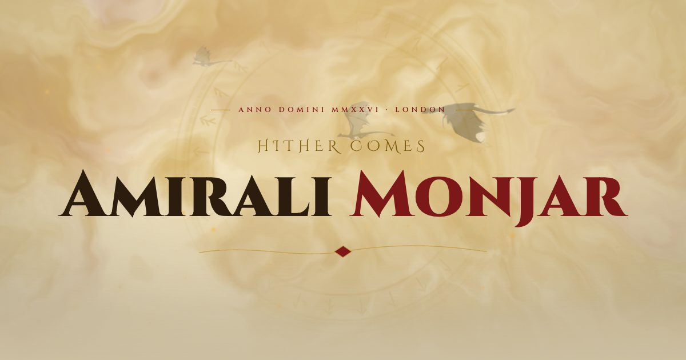

# The Codex of Monjar

The portfolio of Amirali Monjar, live at **[monjar.dev](https://monjar.dev)**: robots, renderers, shaders and creatures, in the manner of an illuminated codex.



Parchment, gold and crimson by day; an emerald wood by night. The sky is a WebGL2 shader of drifting gas, rising embers and a slow ring of runes. Dragons fly at three depths, headings ink themselves in, gilded frames trace their borders as you scroll, and pages turn like leaves of a book.

## What's on it

| Section | What it shows |
|---|---|
| **The Maker** | About me |
| **The Relics** | The five headline projects on a sticky, scroll-driven stage: Mochiro (with its real, pettable animated face), Roads & Runes (a fan of app screens), and highlight reels for Advanced Shaders, the Procedural Animation Study and the Enchanted Game Engine |
| **The Works** | Newer projects, then the elder works from studios, studies and jams, then a ledger of side quests |
| **The Chronicle** | Work and study, as a timeline |
| **The Codex** | Long-form writing (`/blog`) |
| `/works/:slug` | A page per project: stats, write-up, gallery with a lightbox, links |

## Running it

Node 22 (see `.nvmrc`).

```sh
npm ci
npm run dev        # http://localhost:3000
npm test           # data checks: slugs, copy, every media file exists
npm run build      # type-check + build to build/
npm run preview    # serve the build
npm run serve:gh   # serve build/ the way GitHub Pages does (404.html fallback)
```

## Stack

Vite, React 19 and TypeScript, with `react-router` 7 and `motion` for scroll-linked and route animations. The sky is a hand-written WebGL2 fragment shader with no three.js. Styles are plain CSS: design tokens and base styles in `src/styles/` (in cascade layers), and each component's CSS beside it. Fonts (Cinzel, Cinzel Decorative, EB Garamond) are self-hosted through Fontsource.

```
src/
  data/        projects.ts (every work), stack.ts (tech → label + icon), content.tsx (hero, about, chronicle, socials)
  routes/      Home, WorkDetail, Codex (blog index), Tome (a post), NotFound
  components/  one folder per component, with its CSS (Hero, RelicShowcase, ProjectCard, Reel, PhoneFan, …)
  effects/     ArcaneSky (the shader), ParallaxDragons, InkText, GildedFrame, SpellTrail (cursor), PageTurn
  vendor/      the Mochiro face renderer (see Credits)
  lib/         capabilities, theme, media paths, small hooks
scripts/
  vite-route-shells.ts   build plugin: an index.html per route (see Deploying)
  media/                 the media pipeline
public/
  media/<slug>/          compressed images, loops and posters, one folder per work
  posts/                 blog posts as Markdown, listed in manifest.json
```

## Editing content

**A work** is one entry in [`src/data/projects.ts`](src/data/projects.ts). This file has no React in it, because the build plugin imports it too. Its `tier` decides where it appears:

- `relic`: the stage in Chapter II, in the order they're listed.
- `work`: the card grid. `era: "new"` puts it in New Works, `era: "elder"` in Elder Works.
- `archive`: a one-line ledger row that links straight to the repo.

Media goes under `public/media/<slug>/` and is referenced with the helpers at the top of the file:

- `img(slug, file, alt)` for an image.
- `vid(slug, name, alt)` for `<name>.webm` + `<name>.mp4` + `<name>-poster.jpg`.
- `yt(id, alt)` for YouTube, which loads only on click.

`media.reel` plays clips in turn, `media.screens` shows portrait app screens as a fan of phones, and `media.hero: "mochiro-face"` shows the live face. If a slug changes, add the old one to `slugAliases` so its links keep working. `npm test` fails if any referenced file is missing.

**The hero, about text, timeline and socials** live in [`src/data/content.tsx`](src/data/content.tsx).

**A blog post:** add a Markdown file with frontmatter (`title`, `date`, `excerpt`, `tags`) to `public/posts/`, list it in `public/posts/manifest.json`, and name its slug in a project's `posts` to link it from that project's page.

## Media pipeline

Source material lives in the projects' own repos (promo videos, docs screenshots, engine GIFs, live demo captures). `npm run media` (`scripts/media/build-all.sh`) turns it into what the site serves:

- muted 6-second loops as VP9 WebM with an H.264 MP4 fallback, plus posters;
- WebP stills, never upscaled;
- 1200×630 share images.

Each project has its own script (`mochiro.sh`, `roads.sh`, `shaders.sh`, …). Everything is idempotent: existing outputs are skipped unless `FORCE=1`. `budget.sh` fails if any file is over 1.5 MB or the folder is over 30 MB (it's about 18 MB today).

Requirements:

- `ffmpeg` with libvpx-vp9 and libx264, `cwebp`, and macOS `sips`.
- Playwright for `capture-procedural.mjs`, which records the live animation studies. It installs into a scratch directory, never into this package.

## Deploying

Every push to `master` runs `.github/workflows/deploy.yml`:

1. Build.
2. Publish `build/` to [monjar/monjar.github.io](https://github.com/monjar/monjar.github.io), which serves `monjar.dev`. This needs the `DEPLOY_TOKEN` secret.

GitHub Pages has no SPA rewrites, so the build plugin in `scripts/vite-route-shells.ts` writes a real `index.html` for every work and post. Each one has its own title, description and share image, so deep links answer 200 and unfurl properly. Renamed slugs get a small redirect page. `public/404.html` catches everything else and hands the path back to the app.

`/Advanced-Shaders/` and `/Advanced-Procedural-Animations-Study/` on the same domain belong to those repos' own Pages sites, and the plugin refuses to write over them.

## Accessibility and performance

Every effect asks [`useCapabilities`](src/lib/capabilities.ts) first:

- **Reduced motion:** still frames, a cross-fade instead of the page turn, and stacked panels instead of the sticky stage.
- **Touch:** no cursor trail and no hover previews.
- **Save-Data:** no autoplay.
- **No WebGL2:** the CSS sky underneath the shader simply stays.

The shader caps its pixel ratio, lowers its resolution when frames run long, and stops when it's offscreen. Videos load only when they're about to play. The theme follows the OS until you pick one, and is set before first paint, so there's no flash.

## Credits

- The Mochiro face renderer in `src/vendor/mochiro-face` is ported from Mochiro's own web renderer, with a trimmed set of its face animations.
- The dragon is a 28-frame sprite sheet (`src/assets/dragon-sheet.png`).
- Brand icons come from `react-icons` (Simple Icons, Tabler).
